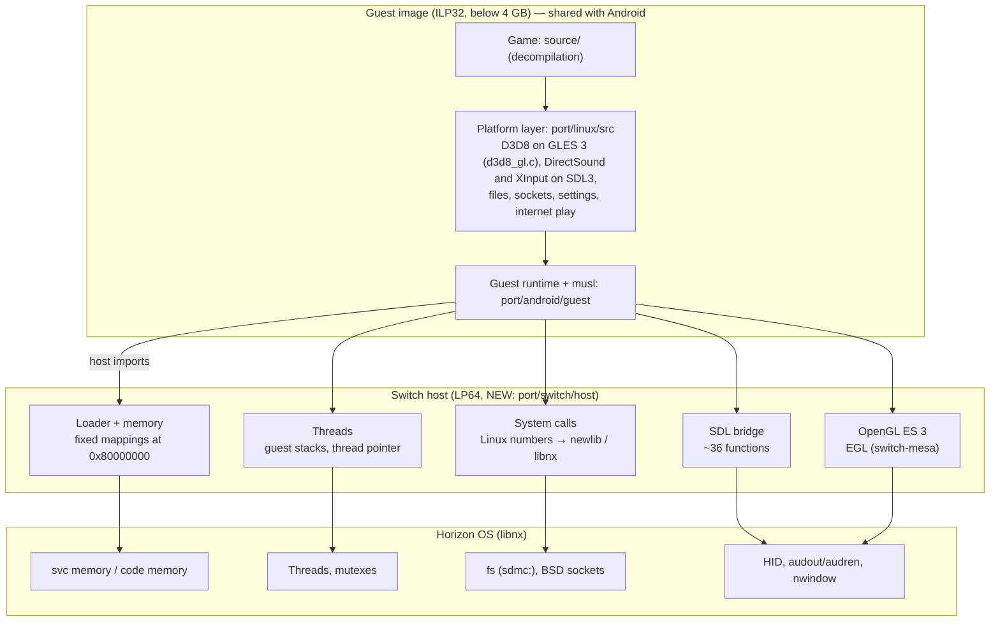

# Halo CE → Nintendo Switch Port Guide
## A native homebrew (`.nro`) build of OpenCE

---

## Overview

**Goal:** run OpenCE (the decompilation of Halo: Combat Evolved, Xbox build
01.01.14.2342) natively on a modded Nintendo Switch (Atmosphère) as a
homebrew `.nro`, launched from the Homebrew Menu.

**Reference port:** the Android build (`port/android/`). The Switch's Tegra
X1 runs 64-bit ARM (Cortex-A57), as Android phones do, so the Android port's
design carries over: the same guest image, a new host.

### How OpenCE runs on ARM64 (and why a plain recompile does not work)

The game's structures and its cache files (`.map`) hold **32-bit pointers**.
The cache files point into fixed addresses: the Xbox memory at
`0x80000000`–`0x88000000`, with the program image above it up to
`0x8c000000` (`port/android/include/halo_android_abi.h`). Compiled as normal
64-bit AArch64 (LP64), the structure layouts change and the maps no longer
load. Android has the same problem and solves it so:

| Part | What it is | Switch |
|------|------------|--------|
| **Guest** | The game (`source/`), the platform layer (`port/linux/src`, `port/linux/game`), a small musl libc and runtime (`port/android/guest`). Compiled by clang for `arm64_32` (ILP32 AArch64: AArch64 instructions, 32-bit pointers), linked to a static image at `0x88000000` | **Reused unchanged**, or with a few `#ifdef`s |
| **Host** | A normal 64-bit program (`port/android/host`, ~3,400 lines) that reserves the guest's memory below 4 GB, loads the image, runs its threads on guest stacks, and answers its calls: Linux system calls, ~36 SDL3 functions, OpenGL ES, files, sockets | **Written again for Horizon with libnx** |

The two ABIs pass 32-bit integers, floats and pointers in the same
registers, so the guest calls the host through simple stubs
(`tools/android_imports.py`, `tools/android_gl_stubs.py`,
`tools/android_posix_stubs.py`). The list of host functions is
`port/android/host_imports.list`.

Reusing the guest has a second benefit: it is compiled by clang without
fused multiply-add and with the vendored musl maths (`halo_math.h`), as every
OpenCE build is, so a Switch plays network games with the PC, Android and
web builds. A game compiled by devkitA64's GCC would not, unless it matched
those options exactly (`-ffp-contract=off`, no system maths).

**The port is therefore: a Horizon host (`port/switch/host`), a `ninja
switch` target, and packaging as an `.nro`.**

---

## Architecture



---

## Phase 0: Environment

The Android build already needs Linux tools; build on Linux (or WSL2).

| Item | Use |
|------|-----|
| Modded Switch with Atmosphère | Running and debugging |
| Xbox disc image (`.xiso` or `.iso`) of Halo: CE | Game data; any version works (PAL maps are converted) |
| OpenCE's Linux build tools: Python, ninja, clang | `configure.py`, the guest build |
| clang with the `arm64_32` target | The guest (the system's clang has it; `--android-guest-cc` selects another) |
| devkitPro: `switch-dev`, `switch-mesa`, `switch-libdrm_nouveau`, `switch-glad` (optional) | The host, EGL and OpenGL ES |
| `nxlink`, Atmosphère's `gdbstub` | Logs and debugging |

```sh
sudo dkp-pacman -S switch-dev switch-mesa switch-libdrm_nouveau
echo $DEVKITPRO   # /opt/devkitpro
```

Build the Android target once to check the guest builds:

```sh
python configure.py
ninja android      # builds build/android/halo_guest.elf, among others
```

> SDL: devkitPro packages SDL2, the guest expects SDL3. The host does not
> need SDL at all: it answers the guest's SDL calls itself (Phase 3.4), so
> implement them on libnx directly.

---

## Phase 1: Feasibility checks (do these first)

Before writing the host, write small libnx test programs that answer these
questions on real hardware. **Questions 1 and 2 decide whether the native
port is possible as designed.**

### 1.1 — Fixed memory below 4 GB

The guest needs read/write memory at exactly `0x80000000`–`0x88000000`
(`HALO_GUEST_WINDOW_BASE`, `HALO_GUEST_WINDOW_SIZE`), the image range
`0x88000000`–`0x8c000000` (`HALO_GUEST_IMAGE_BASE`,
`HALO_GUEST_IMAGE_RESERVE`), and more address space below 4 GB for its heap
and thread stacks (Android reserves pools in free gaps, `host_memory.c`).

On Horizon a process does not choose where its memory goes as freely as
`mmap(MAP_FIXED)` does: the heap, alias and stack regions are placed by the
kernel. The test:

- Print the regions with `svcGetInfo` (`InfoType_AliasRegionAddress`/`Size`,
  `InfoType_HeapRegionAddress`/`Size`, `InfoType_StackRegionAddress`/`Size`,
  `InfoType_AslrRegionAddress`/`Size`).
- Walk `0x0`–`0x100000000` with `svcQueryMemory` and list what is free.
- Try to map memory at `0x80000000` (for example `svcMapMemory` of heap
  memory into a region that covers it, or `svcMapPhysicalMemory` if the
  alias region covers it).
- Try under both launch modes: applet (Album) and title takeover (hold R
  when starting a game). Title takeover gives more memory and services.

This test is `port/switch/feasibility/memory_probe` (`make`, then run the
`.nro` in both launch modes; refer to its README).

**Result (system 23.0.0, Atmosphère): passed, in title takeover.** The
stack, alias and heap regions all lie above 4 GB, so `svcMapMemory` and
`svcMapPhysicalMemory` cannot reach the fixed range (`0xdc01`, `0xfa01`).
`svcMapProcessCodeMemory`, which maps heap memory anywhere free in the
address space region (as the homebrew loader maps each NRO), mapped
`0x80000000`–`0x8c000000` and a 64 MB pool at `0x08000000`, read/write
after `svcSetProcessMemoryPermission`; a file read straight into it matched.
About 3.9 GB below 4 GB is free. Applet mode has 393 MB in all, too little:
**the port needs title takeover.**

### 1.2 — Executable guest code

The guest image's code must be executable at the address it was linked at.
Horizon does not allow writable memory to become executable as `mprotect`
does; it uses code memory (`svcCreateCodeMemory` /
`svcControlCodeMemory`, wrapped by libnx's `jit.h`, or
`svcMapProcessCodeMemory`). The test: copy a small function to an address in
`0x88000000`–`0x8c000000`, make it executable there, and call it.

**Result: passed.** A page of a `svcMapProcessCodeMemory` mapping that has
been made read/write stays data and cannot become executable (`0xd401`). A
page made read/execute straight after the mapping can: the function, copied
into the heap memory before it was mapped, ran at `0x88000000`. So the host
loads the guest image as the homebrew loader loads an NRO: copy the segments
into heap memory, map them at `0x88000000`, then make the code pages
read/execute and the data pages read/write. `host_loader.c` already copies
the whole image before it sets permissions.

### 1.3 — Write tracking of textures and vertices

The renderer notices the game's writes to textures and vertex buffers by
write-protecting their pages and catching the fault (`host_memory.c`, a
SIGSEGV handler). A homebrew NRO does not get such a handler. The host
already has a fallback that compares page contents once a frame instead
(`host_watch_hash.c`, setting `debug.memory_watch = false`). Plan on using
it, and measure its cost on the Switch.

### 1.4 — OpenGL ES 3 through switch-mesa

Create an EGL context on `nwindowGetDefault()` with OpenGL ES 3, and check
the extensions the renderer asks for (`host_gl_has_extension` calls in the
guest, `port/linux/src/gl.h`). Android and the web run the same GLES 3.0
renderer, so a conforming ES 3.0 driver should suffice.

---

## Phase 2: Build integration

Not CMake: OpenCE's build is `configure.py`, which writes `build.ninja`
(`tools/*_build.py` per platform).

1. **`tools/switch_build.py`**, modelled on `tools/android_build.py`:
   - The guest: reuse the Android guest rules (or the same image file).
   - The host: compile `port/switch/host/*.c` with devkitA64
     (`aarch64-none-elf-gcc`, `-march=armv8-a+crc+crypto -mtune=cortex-a57
     -mtp=soft -fPIE`, `-specs=$DEVKITPRO/libnx/switch.specs`, `-lEGL
     -lglapi -ldrm_nouveau -lnx`).
   - Embed the guest image in the NRO's RomFS (`romfs:/halo_guest.elf`) or
     link it in as data.
   - Package: `nacptool --create "Halo CE" "OpenCE" "<version>" halo.nacp`,
     then `elf2nro halo.elf halo.nro --nacp=halo.nacp --icon=icon.jpg
     --romfsdir=romfs`.
2. **`configure.py`**: a `ninja switch` target and a `--devkitpro` option
   (default `$DEVKITPRO`), as `--android-ndk` is done.
3. **A define** for the Switch where the guest must differ (paths, the
   settings that do not apply, no touch controls), for example
   `HALO_SWITCH`, documented in the Defines table of `AGENTS.md`. Keep it
   to a minimum: most differences belong in the host.

---

## Phase 3: The Horizon host

Port each file of `port/android/host` to `port/switch/host`. Sizes are those
of the Android files.

| Android file | Lines | What it does | Switch work |
|--------------|-------|--------------|-------------|
| `host_loader.c` | 116 | Loads the ELF image at its address, fills the import table | Load from RomFS; map the code segments as code memory (1.2) |
| `host_memory.c` | 1094 | Fixed mappings, low-4 GB pools, ART collision handling, write tracking | Much smaller: no ART. Fixed mappings (1.1), pools, the hash-based tracking only (1.3) |
| `host_watch_hash.c` | 180 | Page-compare write tracking | Reuse |
| `host_thread.c` | 206 | Guest threads on guest stacks; the guest's thread pointer per thread | `threadCreate` with a stack in guest memory. The thread pointer is kept by the host (`host_get_tp`/`host_set_tp`), not in a system register, so Horizon's own TLS is not disturbed |
| `host_syscall.c` | 376 | The guest's Linux system calls (~90 numbers), mostly forwarded to the kernel | **The largest new piece**: implement each on newlib/libnx instead (files on `sdmc:`, `futex` with libnx condition variables or `svcWaitForAddress`/`svcSignalToAddress`, `mmap` from the pools, clocks with `armGetSystemTick`, `clone` → `host_thread`) |
| `host_sdl.c` | 512 | The ~36 SDL3 functions the guest calls (`guest_sdl.c`) | Implement on libnx: window/EGL (`nwindow`, EGL), gamepads (`hid`/`pad`), rumble (`hidSendVibrationValues`), audio streams (`audout` or `audren`), ticks, message box (`errorApplicationShow` or a log) |
| `host_gl.c` | 137 | OpenGL ES calls and frame fences | Same, on switch-mesa |
| `host_main.c` | 464 | Start-up: JNI, paths, permissions | `main`: `romfsInit`, `socketInitializeDefault`, `nxlinkStdio`, paths, `appletLockExit` |
| `host_touch.c` | 229 | Touch controls | Optional: handheld touchscreen (`hidGetTouchScreenStates`) for the menus |
| `host_debug.c` | 120 | Sampling profiler (signals) | Skip at first |

The file and socket functions of `port/linux/src/posix_*.c` are also host
functions on Android (`tools/android_posix_stubs.py`). newlib under libnx
provides POSIX files and BSD sockets, so most compile as they are; check
broadcast and multicast for system link, and UPnP.

### 3.1 — Graphics

- EGL on `nwindowGetDefault()`; OpenGL ES 3 context.
- Resolution: 1280×720 handheld, 1920×1080 docked (`appletGetOperationMode`,
  `AppletMessage_OperationModeChanged`); report the new size as a window
  event.
- `display.screen_width`: the 16:9 picture is `0` (automatic), as on Android.

### 3.2 — Audio

The guest's DirectSound runs on SDL3 audio streams (`dsound_sdl.c`). The
host implements the six audio-stream functions; a thread feeds `audout`
(simpler) or `audren` from the stream. On Android the SDL audio callback
runs on a thread with a guest stack (`host_sdl.c`); do the same.

### 3.3 — Input

The guest reads SDL gamepads (`xinput_sdl.c`) and maps them to Xbox
controllers. The host reports Joy-Cons and Pro Controllers as SDL gamepads
with buttons **by position**, as Android does with a DualSense. Do not
design a new control scheme; the game's profiles already choose the button
layout.

| Switch | Xbox (SDL button) | Default function in the game |
|--------|-------------------|------------------------------|
| Sticks | Sticks | Move, look |
| ZR / ZL | Right / left trigger | Fire / grenade |
| B (bottom) | A | Jump, accept |
| A (right) | B | Melee, back |
| Y (left) | X | Action, reload |
| X (top) | Y | Change weapon |
| L / R | White / black | Flashlight / change grenade |
| Stick clicks | Stick clicks | Crouch / zoom |
| + / − | Start / back | Pause / — |

Split screen (players 2–4) and rumble already exist in the game. Set up
Joy-Con pairs with `hidSetNpadJoyHoldType` and the controller applet
(`hidLaShowControllerSupportForSystem`).

### 3.4 — Files and game data

- Data root: `sdmc:/switch/opence/` (the NRO next to it). It holds `maps/`,
  `save/` (`z:\` and `u:\`), `config.toml` and `debug.txt`, as on the other
  platforms.
- The game extracts `maps/` from the disc image itself (`xiso.c`): put the
  `.xiso` in the data root, or copy `maps/` from a PC install.
- Custom Edition maps go in `custom_maps/` as on the other platforms.

### 3.5 — Network

- `socketInitializeDefault()` at start-up; the guest's `posix_net.c` on BSD
  sockets.
- System link: broadcast discovery on the local network.
- Internet play is the same code on every build (`p2p*.c`, DTLS through
  Mbed TLS on Android). Check it against a PC build and a browser
  (`port/web/tests/webrtc_native.mjs`).
- Network version: the guest is the same, so `HALO_PORT_NETWORK_VERSION`
  does not change.

### 3.6 — Lifecycle

- Home button / sleep: `appletSetFocusHandlingMode`, pause audio and the
  game on `AppletMessage_FocusStateChanged`.
- Exit cleanly from the game's quit (`host_exit`) back to the Homebrew Menu.

---

## Phase 4: Testing

- **Logs:** `nxlink -s halo.nro` sends the NRO and shows stdout; the game's
  log is also `debug.txt`.
- **Crashes:** Atmosphère writes crash reports to `sdmc:/atmosphere/crash_reports/`;
  print guest-relative addresses (as `host_memory.c` does) to match them to
  `halo_guest.elf` symbols.
- **Debugger:** Atmosphère's `gdbstub` (enable in `system_settings.ini`).
- **First milestones:** the image loads → `main` runs and logs → the first
  frame (the title screen) → a map loads → sound → controllers → a network
  game with a PC.
- **Network checks:** a Switch against `debug.network_test` hosts on a PC
  (`port/linux/NETCODE.md`).
- Emulators: Yuzu and Ryujinx were discontinued in 2024, and the
  fixed-mapping and code-memory behaviour of 1.1 and 1.2 is exactly what
  emulators get wrong. Test on hardware.

---

## Phase 5: Performance

| | Xbox | Switch |
|---|------|--------|
| CPU | 733 MHz Pentium III | 4× Cortex-A57 at 1.02 GHz |
| Memory | 64 MB | 4 GB (about 3.2 GB to an application in title takeover; much less in applet mode) |
| GPU | NV2A | Maxwell, 256 cores |

The Android build already runs on mobile GPUs of this class, so the renderer
is not expected to be the problem. Measure instead:

1. The cost of the page-compare write tracking (1.3).
2. Frame pacing at 30 and 60 frames per second, docked and handheld
   (`appletSetCpuBoostMode` if needed).
3. Map load times from the SD card.

---

## Phase 6: Extras

- Gyro aiming: Android has gyroscope aiming in its touch controls; a Joy-Con
  version is a new setting (off by default, as `AGENTS.md` asks for
  departures from the stock game).
- HD rumble patterns beyond the game's two motors.
- USB keyboard and mouse in the dock (`hidGetKeyboardStates`,
  `hidGetMouseStates`), with the same bindings as Linux.
- A software keyboard (`swkbd`) for names and chat.

---

## Effort

| Step | Estimate | Note |
|------|----------|------|
| 0: Environment, `ninja android` | 1–2 days | |
| 1: Feasibility checks | 1–2 weeks | **Go / no-go** |
| 2: Build integration and packaging | 3–5 days | |
| 3: Host: loader, memory, threads, system calls | 3–5 weeks | `host_syscall.c` is the largest part |
| 3: Host: SDL bridge, EGL, input, audio | 2–3 weeks | |
| 4: First frame to a playable campaign | 2–4 weeks | |
| 4: Network games | 1–2 weeks | |
| 5–6 | Ongoing | |

Roughly 3–4 months part-time if Phase 1 passes.

---

## Risks

| Risk | Severity | Mitigation |
|------|----------|------------|
| No memory at `0x80000000` or below 4 GB | ✅ Resolved | Phase 1.1 passed with `svcMapProcessCodeMemory` in title takeover |
| Guest code cannot be made executable at its address | ✅ Resolved | Phase 1.2 passed: code pages made read/execute straight after mapping, never writable |
| Page-compare write tracking too slow | 🟡 Medium | Measure; hash only the pages the renderer caches; skip unchanged ranges |
| switch-mesa GLES bugs | 🟡 Medium | Test the renderer early (title screen, then a map); the web build's WebGL 2 limits are a similar restricted target |
| Applet-mode memory too small | ✅ Confirmed | 393 MB in all: require title takeover |

---

## Project rules that apply (from `AGENTS.md`)

- Do not change `source/` without a `port:` comment; keep Switch code in
  `port/switch/` and the host.
- Never read or copy the Xbox SDK's headers.
- Settings go in `port/linux/src/port_config.c` with a default, an
  environment variable and a comment, and in the README's settings table.
- Vendored code goes in `port/third_party/<name>` with a README (upstream,
  version, checksum). The repository is CC0.
- Anything that changes what machines send each other raises
  `HALO_PORT_NETWORK_VERSION`; reusing the guest unchanged does not.
- Add `port/switch/README.md` (building, game data, controls, settings) and
  list it in the Documents table.

---

## Resources

| Resource | Where |
|----------|-------|
| The Android port's design | `port/android/README.md` ("How the port operates", "The fixed addresses") |
| The guest/host ABI | `port/android/include/halo_android_abi.h`, `port/android/host_imports.list`, `port/android/guest/runtime/guest_host.h` |
| libnx | https://switchbrew.github.io/libnx/ |
| Switch homebrew examples (EGL, audio, HID, sockets) | https://github.com/switchbrew/switch-examples |
| Horizon system calls and memory regions | https://switchbrew.org/wiki/SVC |
| devkitPro | https://devkitpro.org/wiki/Getting_Started |

---

> This guide is for personal use. You need your own copy of Halo: Combat
> Evolved for the Xbox. Do not distribute the game's data.
